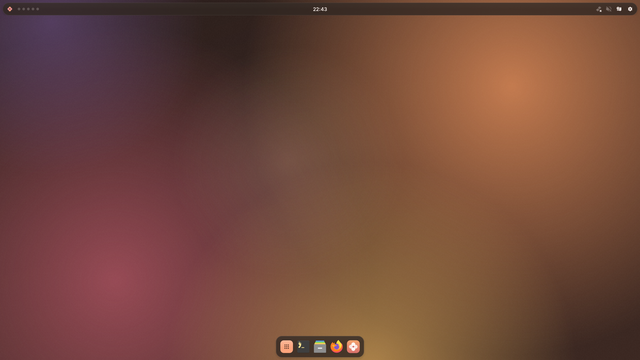
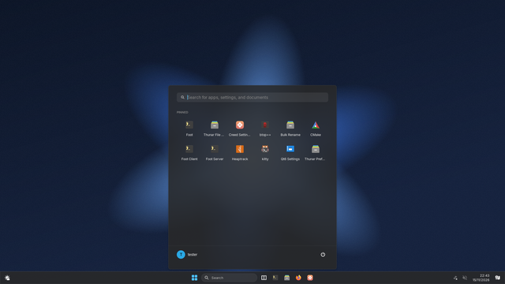
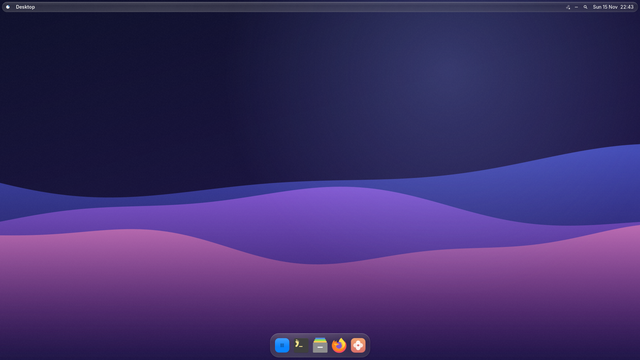
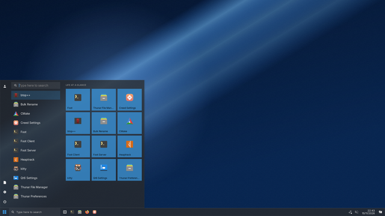
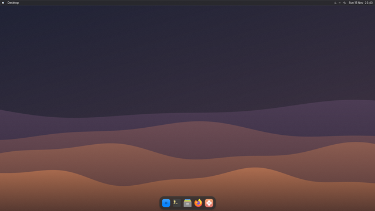
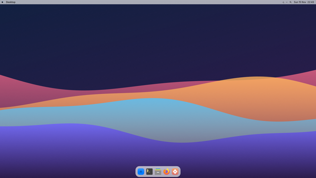
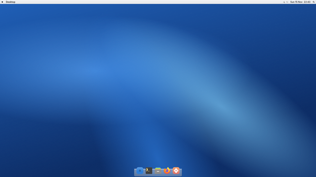

# Creed

A light, hand-tuned Hyprland desktop that can wear seven different looks. Switching
the look changes the whole desktop at once: Creed's own style, Windows 11, Windows 10,
macOS Tahoe (Liquid Glass), macOS Sequoia, macOS Big Sur or Classic Aqua.

The shell (bar, dock, launcher, control center, notifications, dashboard, overview and
wallpaper) is a single small Rust program. It draws everything itself, so it stays under
**60 MB of RAM** with all of that on screen.

| Creed | Windows 11 | macOS Tahoe |
|---|---|---|
|  |  |  |

| Windows 10 | macOS Sequoia | macOS Big Sur | Classic Aqua |
|---|---|---|---|
|  |  |  |  |

---

## Install

Requirements:
- **Arch Linux or an Arch-based distribution** (EndeavourOS, CachyOS, Garuda and others)
- **Hyprland 0.57 or newer** (the version with Lua configs)

```bash
git clone https://github.com/UmxRK/creedfiles.git
```

```bash
cd creedfiles
```

```bash
./install.sh
```

The installer asks for your password **once**. It then:

1. checks your system and shows the detected hardware (GPU, CPU, RAM, laptop or desktop)
2. installs the packages Creed needs (anything already installed is skipped)
3. builds Creed and installs it system-wide
4. offers free look-alike icon themes for the Windows and macOS modes (Fluent, WhiteSur), downloaded into `~/.local/share/icons`
5. backs up your existing configs to `~/.config/creed-backup/<date>/` and installs Creed's
6. offers optimisation tweaks, with the ones recommended for your hardware pre-selected; each is explained before anything runs
7. optionally sets up the SDDM login screen

Log out, pick **Hyprland** at the login screen, and **Creed Settings** opens once so you
can choose a mode.

Installer options: `--yes` (accept the recommended defaults), `--dry-run`,
`--no-tweaks`, `--no-assets`, `--mode <id>`, `--update`.

From the AUR-style package in `packaging/PKGBUILD`, run `creed setup` as your user after
installing it.

### Updating and removing

| | Command |
|---|---|
| Update a git install | `creed update` |
| Update a package install | `paru -Syu` (or `yay -Syu`) |
| Remove Creed | `creed uninstall` |

`creed uninstall` reverts every applied tweak, restores your original config files
byte-for-byte from the backup, and removes Creed's lines from your shell rc files. Your
Creed settings in `~/.config/creed` are kept in case you come back.

---

## Modes

| Mode | Look |
|---|---|
| `creed` | Soft rounded pills, warm colours from your wallpaper, springy motion, floating top bar and dock |
| `win11` | Centred taskbar, Mica, rounded windows, Start with pinned apps, Snap Layouts, Widgets, Task View |
| `win10` | Left taskbar with search box, Acrylic, square corners, tiled Start, full-height Action Center |
| `mac-tahoe` | Liquid Glass bar, dock and panels with refraction and a moving edge highlight, magnifying dock |
| `mac-sequoia` | Frosted vibrancy menu bar, Control Center, Mission Control, magnifying dock |
| `mac-bigsur` | Bright Big Sur style: light appearance and a soft translucent menu bar |
| `mac-aqua` | Pinstripes, glossy menu bar and the reflective shelf dock |

Switch modes in **Creed Settings → Modes**, with **Super+Ctrl+M**, or with:

```bash
creed mode set win11
```

A mode switch re-themes all of these together:
- the shell: bar, dock, menus, launcher, control center and notifications
- window rounding, borders and gaps, and whether windows float or tile
- animations
- keyboard shortcuts (Windows-style, Mac-style or Creed)
- GTK and Qt apps, icons and cursor
- the foot and kitty terminals and the starship prompt
- the hyprlock lock screen
- the MangoHud overlay
- Firefox (optional)
- the SDDM login screen (optional)

No Microsoft or Apple artwork, logos or fonts are included. The modes use free look-alikes.

### Liquid Glass and other materials

The Glass page in Settings exposes every control:
- refraction, edge thickness and clarity
- blur radius and passes
- frost (panel opacity) and tint colour
- shine strength, and whether the shine follows the pointer
- separate frost and shine values for the bar, dock, launcher, control center and notifications

Hyprland 0.57's built-in glass and acrylic blur do the refraction. Creed adds the panel
tint, rim light and specular highlight on top.

Quality is set to **Automatic** by default. On integrated or weak GPUs it switches to a
cheap frosted blur that keeps the look. You can force any tier from Low to Ultra.

## Keyboard shortcuts

Every profile has these:

| Keys | Action |
|---|---|
| Super+G | Game Mode on or off |
| Super+Z | Snap Layouts |
| Super+V | Clipboard history |
| Super+. | Emoji picker |
| Super+Ctrl+M | Change mode |
| Print / Shift+Print | Screenshot of a region / of the whole screen |
| Super+1…9 | Go to a workspace |

| Creed profile | Windows profile | Mac profile |
|---|---|---|
| Super+Space: launcher | Win (tap): Start | ⌘Space: Spotlight |
| Super+Return: terminal | Win+E: files | ⌘Q / ⌘W: quit / close |
| Super+Q: close window | Alt+F4: close window | ⌘M / ⌘H: minimise / hide |
| Super+A / N / D: control center, notifications, dashboard | Win+A / N / W: quick settings, notifications, widgets | Ctrl+Up: Mission Control |
| Super+Tab: overview | Win+Tab: Task View · Alt+Tab: switch windows | ⌘F4: Launchpad |
| Super+L: lock | Win+L: lock | ⌘Ctrl+Q: lock |
| Super+F / T: fullscreen / float | Win+Arrows: maximise and snap | ⌘Ctrl+F: full screen |

You can keep Creed's keys in every mode under **Settings → Desktop → Shortcuts**.

## Tweaks

```bash
creed tweak list
```

```bash
creed tweak explain bbr
```

```bash
creed tweak apply bbr
```

```bash
creed tweak revert bbr
```

| Category | Tweaks |
|---|---|
| Gaming | GameMode tuning, `vm.max_map_count`, NTSync, NVIDIA Wayland driver options, split-lock penalty off, raw mouse input |
| Network | Wi-Fi power saving off, BBR + fq, IPv6 privacy addresses, encrypted DNS (DNS-over-TLS) |
| System | zram, per-drive I/O schedulers, journal size cap, faster shutdown, no wait-online at boot, systemd-oomd |
| Battery | power profile follows the charger, sound-card power saving, USB autosuspend (input devices excluded) |
| Cleanup | old package downloads, orphaned packages, old logs, app caches, Steam shader caches, closing heavy background apps, releasing cached memory |

The rules for tweaks:
- **Every tweak is explained before it runs.** You see what it does, which files it
  changes, whether it needs a reboot and whether it can be undone.
- **Reversible tweaks** back up every file they touch. Revert restores the originals
  byte-for-byte. On Btrfs with Snapper, a snapshot is also taken before each system change.
- **Cleanups delete data**, so they can't be undone. They always show exactly what will go
  (sizes, package names, app names) and need an explicit confirmation every time.
- **Admin rights are needed only once.** The installer adds a polkit rule that lets admins
  (members of `wheel`) run Creed's helper without a password. The helper refuses any file
  that isn't owned by root, and only runs the tweak scripts shipped in
  `/usr/share/creed/tweaks`.

## Game Mode

Game Mode switches on by itself when a game appears, and off again when the game closes.
It recognises:
- Steam games
- gamescope
- Lutris and Heroic launches
- a full-screen Wine or Proton window

You can also toggle it with **Super+G**. While it is on:
- the bar, dock and wallpaper are unloaded, which frees most of Creed's memory
  (notifications and the volume OSD stay)
- Hyprland's blur, shadows and animations are paused, and screen tearing is allowed for the lowest input latency
- GameMode registers the game for the performance CPU governor

When the game closes, everything is restored exactly.

## Memory

Measured as PSS (proportional set size, the honest number for shared memory). The test
draws every always-on surface (bar, dock, wallpaper and the notification daemon), then
opens and closes every panel 200 times before measuring:

```bash
tests/ram.sh 2560x1440 1 20 60 mac-tahoe
```

| Setup | Limit | Measured |
|---|---|---|
| 1 monitor up to 1440p, any mode | 60 MB | see `tests/RESULTS.md` |
| 4K or multi-monitor | 120 MB | see `tests/RESULTS.md` |

Run `creed ram` to check your own machine.

On Hyprland, Creed frees its copy of the wallpaper once the compositor has uploaded it, so
real sessions use less than the test numbers. The test compositor (sway with a software
renderer) keeps the buffer.

## Configuration

Settings are layered. Each layer overrides the ones before it:
1. `/usr/share/creed/defaults.toml`
2. the mode's `mode.toml`
3. `~/.config/creed/creed.toml`
4. `~/.config/creed/overrides.toml`
5. `[modes.<id>]` sections in `overrides.toml`

Each layer is checked on its own, so errors point at the exact file and line. If a config
has a mistake, the shell keeps the last good settings and tells you where the problem is.

```bash
creed config validate
```

```bash
creed config set bar.position bottom
```

```bash
creed config set glass.refraction 0.7 --mode
```

The `--mode` flag applies a change to the current mode only.

Your own Hyprland settings (monitors, input, extra binds) go in
`~/.config/hypr/user.lua`. Creed never overwrites that file.

## Accessibility

- Every panel can be used from the keyboard: Tab, arrow keys, Enter and Escape, with a visible focus ring.
- Every bar, dock and panel element is exposed to screen readers (Orca) through AT-SPI.
- Input methods (fcitx5, IBus) work in every text field, including Chinese, Japanese and Korean.
- Fractional scaling, a text-size setting, high contrast and reduced motion are supported.

## Development

```bash
cargo test --workspace
```

```bash
tests/run-all.sh
```

`tests/run-all.sh` runs the full suite inside an Arch root with headless sway and
Hyprland's own `--verify-config`:
- unit tests
- every mode's generated Hyprland config, in every glass, motion and colour-scheme variant
- apply → re-apply → status → revert for every tweak, with a byte-for-byte restore check
- a check that cleanups delete only caches
- setup → uninstall restoring a user's original files
- the memory gate
- screenshots of every surface in every mode

Layout:

| Path | What it is |
|---|---|
| `crates/creed-core` | Config, palette, templates, hardware detection, Hyprland IPC, tweak engine |
| `crates/creed-shell` | The Wayland layer-shell UI (cairo/pango into shared-memory buffers) |
| `crates/creed` | The `creed` command |
| `settings/creed-settings` | GTK4/libadwaita settings and welcome app (runs only while open) |
| `modes/` | One folder per mode: `mode.toml`, preview |
| `templates/` | Hyprland Lua, GTK, Qt, terminals, starship, hyprlock, MangoHud, Firefox |
| `tweaks/` | The tweak catalogue (`tweak.toml` plus apply / revert / status / plan scripts) |
| `helper/`, `packaging/` | Root helper, polkit rule, desktop entry, PKGBUILD |
| `sddm/` | Login screens (Creed, Windows, macOS layouts) |

## Known limits

- **Overview window previews.** The overview shows each window's app icon and title, not a
  live preview. Live previews need a capture protocol that couldn't be tested in this build
  environment.
- **macOS-style menu bar.** It shows the focused app's name plus a window menu. App menus
  are not exported: most Wayland apps don't publish them.
- **No titlebar buttons.** Windows have no minimise / maximise / close buttons yet. In
  Windows and Mac modes those actions are on the usual shortcuts and in the window menu
  (click the app name in the Mac menu bar, or press Super+Z). Titlebars would need the
  `hyprbars` plugin, which could not be built or tested here.

## Licence

GPL-3.0-or-later. Emoji data © Unicode, Inc. (Unicode License v3); see `crates/creed-shell/data/NOTICE`.
